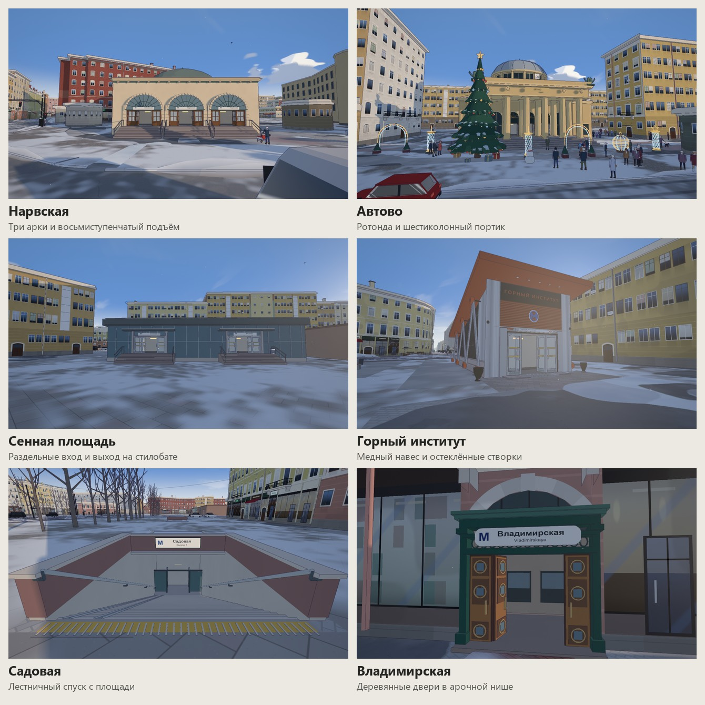

# Metro (module `metro`) — design and handoff

## Уличные входы в районных сценах · 17.10.0

Каталог охватывает 44 станции в 21 опубликованном районе. Для каждого названия приведены фотографии фасада, описание дверей и тип подхода. В перечне OSM отдельно указаны корпус, уровень, координаты и все районы, откуда можно подойти к этой точке. В исторической сцене `strip.html` пассажир проходит в действующую подземную сеть. На районных страницах за дверьми доступны наземный тамбур или нижняя площадка уличного перехода. [Фотокаталог и точки входа](research/metro-entrances.md) · [Двенадцать индивидуальных станционных зданий](research/metro-specialist-entrances.md) · [Уличные двери семи центральных станций](research/metro-central-entrances.md).

| Место | Исполнение у входа | Основание |
|---|---|---|
| «Нарвская» | Купол над барабаном, три каменные арки с зелёными веерными переплётами, деревянные двери и восьмиступенчатый подъём к портику | [Фотографии](https://www.metrowalks.com/ru/petersburg/kirovsko-vyborgskaya/narvskaya) · [Марш на карте](https://www.openstreetmap.org/way/909651684) |
| Сенная площадь | Семь ступеней выводят к поднятым дверям «Сенной площади». Рядом расположен отдельный каменный портал «Спасской» с подходом с площади | [Ремонт стилобата](https://metro.spb.ru/news/item/id/2634) · [Лестница у входа](https://www.openstreetmap.org/way/81115440) · [Лестница у выхода](https://www.openstreetmap.org/way/81115439) |
| «Чкаловская» | Раздельные площадки за десятью и двенадцатью ступенями. Остекление продолжается вдоль стены под тёмным козырьком | [Входной марш](https://www.openstreetmap.org/way/368829963) · [Выходной марш](https://www.openstreetmap.org/way/368829965) |
| «Пионерская» | Складки кровли выступают над стеклянным фасадом. На восточных подходах игрок поднимается по четырём или пяти ступеням, пересекает террасу и подходит к створкам. У северного входа сохранён ровный подход к двери | [Ремонт стилобата и лестниц](https://www.gov.spb.ru/gov/otrasl/c_transport/news/264557/) · [Северо-восточный марш](https://www.openstreetmap.org/way/385602211) · [Юго-восточный марш](https://www.openstreetmap.org/way/385602212) |
| «Путиловская» | Под общим каменным порталом виден золотистый потолок. Две дверные группы установлены в глубине по направлениям крытых пешеходных дорожек | [Вид здания](https://www.metrowalks.com/ru/petersburg/krasnoselsko-kalininskaya/putilovskaya) · [Входная дорожка](https://www.openstreetmap.org/way/1462153999) · [Выходная дорожка](https://www.openstreetmap.org/way/1462153998) |
| «Чёрная речка» | Ребристый закруглённый фасад, наружная площадка и семь ступеней перед северной дверной группой | [Фотографии](https://www.metrowalks.com/ru/petersburg/moskovsko-petrogradskaya/chiornaya-rechka) · [Северный марш](https://www.openstreetmap.org/way/151810233) |

Формы створок, фурнитура, веерные фрамуги, каменные клинья, капители, карнизы и складчатые секции смоделированы в Blender. Исходники для повторного экспорта — `tools/model-central-metro-entrances.py`, `tools/model-metro-pavilion-doors.py` и `tools/model-regional-metro-entrances.py`. Фотографии задают облик. Ширина проходов и высота подступенков в игре подобраны в метрах, измеренное на карте число ступеней указано отдельно.

Региональные проверки запускаются через `node tools/area.mjs <район> tools/regional-metro-entrances-test.mjs`, для зимы добавляется `--winter`. У центральных зданий, уличных спусков и индивидуальных павильонов свои проверки в `tools/central-metro-entrances-test.mjs`, `tools/regional-underpass-test.mjs` и `tools/specialist-metro-entrances-test.mjs`. Они проводят игрока через наружный порог и обратно и проверяют видимый проём и опору непосредственно в сцене.

Everything below the street: vestibules, escalators, station halls, passages, tunnels, trains, rides in real time and the wayfinding signage. The historical Moscow Railway Station–Nevsky Prospekt–Admiralty scene has **seven individually modelled underground halls** (Vosstaniya, Vladimirskaya, Mayakovskaya, Dostoevskaya, Gostiny Dvor, Nevsky Prospekt, Admiralteyskaya); each line end is ONE out-of-strip neighbour station (`built: false`) served by the shared generic hall as a terminus (section "Strip cut" below). Contract with the engine: `docs/UNDERGROUND.md`.
Research (of the original project, not in this repo): `docs/research/metro.md`, `metro-west.md`, `metro-ops.md`, `metro-wayfinding.md`, `metro-signs-kit.md`. Tests: `node tools/metro-test.mjs` (sections 1-4 and 6-9; `--only 6,9 --exits gostiny,nevsky` for a part), `node tools/metro-ride-audit.mjs`, `node tools/metro-load-errors.mjs`, build check `node tools/check.mjs metro`.
**Reading order:** the round section first (current state); the sections after it are per-session history. Where they speak of the map panel / destination panel, 80 s periods, one-by-one car jumps or "intermediate stops not done", the round section and "How it works" are right (the map panel was removed: rides run to the end of the line in real time, stopping everywhere).

## Strip cut (n4spb): 7 real halls + generic-hall termini

The metro of the original project (24 real halls, lines 1-6) was cut to the strip: only the stations whose hall AND vestibules lie inside the play rectangles stay. Nothing was invented: every kept row is the original row.

| line | stations of `STATIONS[line]` (neighbours in lowercase italics are `built: false`, served by the generic hall) | real hops (s) |
|---|---|---|
| 1 | _Chernyshevskaya_, **Vosstaniya**, **Vladimirskaya**, _Pushkinskaya_ | 122, 87 (real tunnel), 112 |
| 2 | _Sennaya_, **Nevsky Prospekt**, _Gorkovskaya_ | 96, 173 |
| 3 | _Vasileostrovskaya_, **Gostiny Dvor**, **Mayakovskaya**, _Ploshchad Aleksandra Nevskogo 1_ | 221, 129 (real tunnel), 143 |
| 4 | _Spasskaya_, **Dostoevskaya**, _Ligovsky Prospekt_ | 140, 96 |
| 5 | _Sportivnaya_, **Admiralteyskaya**, _Sadovaya_ | 179, 104 |

* **Line ends ("option C").** A ride runs along `net.ahead()` to the neighbour and ends there: the train arrives with open doors in the shared generic hall relabelled with the neighbour name (`showGeneric`), the exit shows the polite closed-exit sign, the rider can alight and board the opposite track (the chain back runs through the in-strip stations); toast «Поезд прибыл на конечную станцию». Run times are the real HOPS rows, so nothing is modelled. `LINES[x].to / toEn` name the neighbours (the `Поезд до станции «...»` toast, the hanging "to the trains" boards, the in-car strips).
* **Real tunnels** (both ends in the strip): Vosstaniya <-> Vladimirskaya (built inline in `metro.js`, 848 m) and Gostiny Dvor <-> Mayakovskaya (`st-gd.js` `link()`, 1609 m). Every other hall end is a black-disc stub (`stubs.js`): Vosstaniya N, Vladimirskaya S, Mayakovskaya +z, Dostoevskaya both, Nevsky both, Gostiny Dvor W (3.5 m dead stub), Admiralteyskaya both (70 m); a ride leaves through the stub and jumps into the generic tunnel (`ride.js`). `tools/metro-ride-audit.mjs` part A (18 routes from the 7 halls): 0 m in rock, yaw step < 0.6 deg, no drawn disc crossed. Known limitation: the 40 m extension tube behind a dead stub runs straight along the hall axis and is not bent away from neighbouring structures, so at some ends (Gostiny Dvor W, Mayakovskaya +z, both ends of Nevsky Prospekt) foreign vaults or corridor linings poke through the tube wall for about 1-2 s at the start or end of such a ride; the jump into the generic tunnel hides the rest.
* **Transfers** (`TRANSFERS`): Vosstaniya - Mayakovskaya, Vladimirskaya - Dostoevskaya, Gostiny Dvor - Nevsky Prospekt (all on foot through passages that are built).
* **Static data** (`data/metro.js`): `SHAFTS` 12 (8 escalator shafts under buildings + the 4 `stairs` holes of the Nevsky pits), `DOORWAYS` 13, `FRAMES` 7, `ESC2` 6, `ROOMS` 4, `PITS` 4; `services.metro.entrances` = 13 doorways + 4 pits. `SUBWAY` (OSM tunnel ways) is no longer read by any code.
* **Network map** (`signs.js` `MAP_ROWS`, one shared texture): 5 rows pivoted on a built station (Vosstaniya, Mayakovskaya, Nevsky, Admiralteyskaya, Dostoevskaya) so that the interchange connectors stay vertical; line 6 is gone.
* **Removed** (git history of the original project keeps them): the builders `st-gork / st-petr / st-sport / st-sport2 / st-chk / st-vo / st-gorny / st-chernyshevskaya / st-pushkinskaya / st-zvenigorodskaya / st-tekhnolog / st-pan / st-ligovsky / st-sennaya / st-sadovaya / st-spasskaya`, the hubs `hub-*.js`, the real links `links-*.js`, the kits `pavilion / petro-kit / vo-kit / travelator / hall-vault`, the dead map panel `map-ui.js`, the data files `data/metro-{vitebsky,tekhnolog,chernyshevskaya,east}.js` (the `define(T)` contract), the per-node tests, `tools/metro-frames.mjs`, `services.metro.pavilions` and `ctx.metro.petro / east / hub`. The sections below that describe those stations (round table rows, Petrograd side, Vasilievsky Island) are history; the West extension section and "How it works" describe live code.
* **Budget:** canvas textures of the module 26.9M px (`node tools/check.mjs metro`, warning above 24M; ~30.9M before the cut).

## 2026-10-15 realism round: honest rides, real interchanges, wayfinding

Plan and diagnosis: `C:\Users\user\.claude\plans\let-s-start-improving-the-glittery-giraffe.md`. User decisions: **real time** (real hop times and dwell, no compression), **no map pop-up and no zoom** (schemes exist only as textures in the world), **realistic interchanges** (the missing interchange stations are researched and built with their real passages). Constraints that stay: no flags, no sirens or alarms (one soft chime + calm toasts), `docs/UNDERGROUND.md`, `docs/PERFORMANCE-CONTRACT.md`.
Research: `docs/research/metro-ops.md` (operations, hops, headways, announcements, interior gaps), `metro-wayfinding.md` (boards, bands, schemes, in-car strips), `metro-south-sennaya.md`, `metro-south-vitebsky-tekhnolog.md`, `metro-east.md`, `metro-east-wiring-chernyshevskaya.md`, `metro-signs-kit.md`, `metro-frames-south-east.md`.

### What changed

| area | now | where |
|---|---|---|
| **rides** | a ride is a chain of legs to the END of the line in the train's direction; stops at EVERY station; real run times (`HOPS`), dwell 25 s (35 s at interchanges); nothing is chosen on a map; boarding by walking through an open door or `[E]`; getting off at any stop (`[E]` «Выйти на платформу» or walking out); terminus: doors stay open, toast «Поезд прибыл на конечную станцию …» | `metro/ride.js` |
| **platforms** | cycle 120 s per track (arrive 14 / dwell 28 / depart 12); `hold(tk)` / `release`: the track of every stop of a ride is HELD (scheduled train hidden) from the start of the leg until the ride train leaves, `dispatch()` after departure, `present()` after getting off: no more trains standing in each other | `metro/platform.js` |
| **discs** | every black disc (stubs, real tunnels, the free end of a partial link) is registered (`registerDisc`, `DISCS` = `ctx.metro.discs`) and kept out of the static batching (`ctx.noBatch`, ~60 small circles) so a ride can hide the discs of its own track at both ends; before, the toggle was a no-op on merged meshes and every generic ride drove through a black wall | `metro/stubs.js`, `metro.js` (`discLeg`) |
| **tunnels** | the generic route follows the real tube up to the jump point (no more ~90 m "in rock" on line 1 / L3 ends); **whole-train jump** between tube and generic tunnel when the rider's car is wholly behind the disc (margin 1 m), cars beyond the tube end are not drawn; lamps every 9 m, rings every 1 m, bed 1.2 m: every tube repeats every 18 m, the generic tunnel wraps by 288 = 16 x 18 m (**lamp phase** continues across the jump); smooth heading along polylines (no yaw steps); `metro-tunnel` look zone (riding, phase running, 30 m clear of both mouths: sun 0, ambient 0.55, dark fog, far 220) while halls keep `LOOK_UNDER` | `ride.js`, `stubs.js`, `tunnel.js`, `metro.js` |
| **generic hall** | serves the neighbour terminus of every line end; re-labelled for the NEXT stop while the train is in the tunnel (boards and bands are `noBatch`, so the swap of the name texture actually shows) | `hall-generic.js`, `metro.js` (`showGeneric`) |
| **car interior** | transparent door and cab glass, ride bounds x = +-0.82 (the wall skin is no longer clipped), **in-car line strips** over the doors (two per side, 3.6 x 0.42 m, one canvas per line and direction `strip-<line>-<dir>`, in the style of the stock: 81-717 white panel with pie-disc transfers, NeVa Bronze Horseman + green digits + black LED bar, Baltiets dark LCD with a blank rectangle for the live next-station text); a runtime LED marker moves to the current stop (`train.setStop(idx)`, `train.setLine`) | `metro/train.js` |
| **signage kit** | `metro/signs.js`: `hangBoard` (lit hanging box: exit / to-trains / transfer / rules sections), `lineScheme` (linear scheme on track walls and pylon faces), `trackBand` (band under the cornice with small bilingual names), `networkMap` (white network map in frames, painted by `paintMap`), `noBoardingPlaque`, `badge`, `exitPictogram`. Textures are shared per type / line (canvas budget is now 26.9M px); official colours 1 #D6083B, 2 #0078C9, 3 #009A49, 4 #EA7125, 5 #6E0A78. Applied in the older halls and in every new hall | `metro/signs.js`, `docs/research/metro-signs-kit.md` |
| **network data** | `HOPS` (real metres + seconds per adjacent pair, model 40 s + m / 18 m/s elsewhere), `TRANSFERS` (node ids, kind, walking time), `net.route(a, b)` planner (tests / services; never shown to the player), 120 s cycle | `data/metro.js`, `metro/net.js` |
| **removed nodes** | Pushkinskaya / Zvenigorodskaya, Tekhnologichesky Institut 1 / 2, Chernyshevskaya, Pl. Aleksandra Nevskogo 1 / 2 + Ligovsky, the Sennaya hub: not in the strip (see "Strip cut"); they are neighbour termini of the lines now | - |
| **built stations** | 7 halls: Vosstaniya, Vladimirskaya (line 1), Mayakovskaya, Gostiny Dvor (3), Dostoevskaya (4), Nevsky Prospekt (2), Admiralteyskaya (5) (`net.ALL.filter(s => s.built)`) | `data/metro.js` |

Still open: standing-train floor and body colliders (a player entering through a door window still drops to the track bed: check `ride.js` / `platform.js`), walking from car to car, people on the new platforms.

### Data contract

`data/metro.js` is plain data + a few pure functions (no three.js); it is read by `layout.js` / `lib/massing.js` / `city/passages.js` / `streets.js` BEFORE any module builds (`SHAFTS` = `layout.GROUND_HOLES`, `DOORWAYS` = `layout.DOORWAYS`), so the rows must be filled at import time there. Rule: frames come from the PCA of the OSM platform polygons, +z toward the higher station index of the line. (The `define(T)` node files of the 2026-10-15 round were removed with their stations.)

### Tests and tools (run serially, one GPU job at a time)

| tool | what it checks |
|---|---|
| `node tools/metro-ride-audit.mjs [--only A,B,C] [--out shots/metro/audit] [--q medium] [--rides 1,2,3,4,5,6,7,8] [--dests 3] [--every 2] [--look fwd\|board] [--no-shim]` | **A** route geometry for every built station x track x the next `--dests` stops: metres "in rock" (> 4 m from every hall box, real tube, stub and the generic axis), largest yaw step per frame at 60 Hz, black disc planes crossed by the rider's eye (drawn = still visible after `onRideStart`). FAIL: rock > 0 m, yaw step > 1.5 deg, a drawn disc crossed. **B** eight live rides through the chain-of-legs API (the two real tunnels and six generic-hall termini): screenshots from the rider every `--every` s, near-black fraction and mean luma, a see-through probe (ride train hidden: the picture must change), held track while the ride train stands at a stop (no overlap), boarded / arrived within 320 s / got off. Exit code 1 on any failure |
| `node tools/metro-test.mjs [--only 1,2,...] [--exits a,b]` | sections 1-4 and 6-9: 1 load, 2 street + escalator, 3 platform + ride (Vosstaniya -> Vladimirskaya -> the Pushkinskaya terminus in the generic hall), 4 corridors + doors + Mayakovskaya -> PAN-1 terminus, 6 ways out of every station, 7 transfers on foot, 8 walk into an open door, 9 west stations (rides incl. the real Gostiny Dvor <-> Mayakovskaya tunnel, the chains ahead of the 7 halls, a ride to every line end, platform doors) |
| `node tools/metro-load-errors.mjs [modules]` | loads `?only=metro` headless (GPU browser) and prints every module / console error with its stack (first thing to run after an edit that breaks the module) |
| `node tools/metro-prof.mjs` | node-only load profile of the module (canvas pixels by painter, batching, release pass) |
| `node tools/check.mjs metro` | triangles, canvas pixels (now ~26.9M px), build ms |

Performance (numbers: see docs/PERFORMANCE.md section 2026-10-15 metro). Guardrails of the round: everything static via `ctx.addStatic`, `noBatch` only for runtime-toggled meshes (discs, relabelled generic boards, LED markers, door leaves), no per-frame scans (the ride update is O(1), the tunnel zone test is one check per frame), shared sign textures, tunnels built in 110 m chunks, bake as the last step.

## Status (second iteration: user feedback applied)

| done | notes |
|---|---|
| entrances | rotunda: big lit blue "М МЕТРО Площадь Восстания" roof signs over both doors, a lit pylon beside the entrance walk, wide doors with a floor-level threshold, nothing in the way (door leaves, corridor ends and ticket machines no longer block); every entrance has an `[E]` prompt «Вход в метро · Enter the metro» (steps inside); blue "М" totems at the other doors. `tools/metro-test.mjs` walks in through all 7 doors with real physics |
| Vosstaniya (1, -58) | rotunda + pylon hall + 3-lane escalator (down / down / UP, moving steps AND moving handrails) + **Vosstaniya-2**: vestibule room at the OSM entrance n1109163066 (597.5, 341) of the station building, a back-running escalator and a 100 m passage to the junction hall in front of the south end of the platform |
| Vladimirskaya (1, -55) | white-marble pylon hall, vestibule in w61738351, escalator, curved lower corridor, real tunnel to Vosstaniya, passage to Dostoevskaya (S end) |
| Mayakovskaya (3, -51) | now a three-vault PYLON hall (grey steel-look dado, red smalt-mosaic track walls), Nevsky Atrium vestibule (entrance + Marata exit corridor), escalator, lower corridor, transfer passage to the Vosstaniya junction hall |
| Dostoevskaya (4, -64) | column hall (granite columns, wall lanterns, orange name bands, 7-car 81-717), vestibule room in the Regent Hall w38578114 (door at the facade edge, 10 m from the OSM node), AXIAL escalator (the hall lies on its extension, so its frame is NOT the OSM platform polygon: it is about 60 m WSW of it), passage to Vladimirskaya |
| trains | on every platform both directions, 120 s cycle per track (arrive 14 s, dwell 28 s, depart 12 s), offsets per station; walking into an open door or `[E]` boards; the ride runs to the end of the line and stops at every station (round section; the map panel of this iteration is gone) |
| ways out | every real station (V, V-2, Vl, M, D) is walked in the test from the platform up the UP lane to the pavement; destinations outside the map end in the generic hall with the polite closed-exit sign; the map panel marks the stations with an open exit (green ↑) |
| safety | service stairs from the track bed to the platform at both hall ends; the terrain hole of an escalator is cut only over the 13 m shaft mouth (the street above the tunnel stays solid) |

Passages (all walked both ways by the test): Mayakovskaya <-> Vosstaniya (via the junction hall at the south end, 209 m), Dostoevskaya <-> Vladimirskaya (about 190 m), Vosstaniya-2 -> junction hall.
Corridors are built at the end of `build()`; a corridor that crosses a tunnel / stub at the same level is lifted over it automatically (`autoClear`); tunnel stubs at the ends where a corridor leaves are only 6 m
long (the part behind the black disc is shown only while a ride is running).

Not done / next (state of the second iteration; intermediate stops are done since 2026-10-15): walking through the train from car to car; ambient hum / a single soft chime (nothing alarm-like exists: no beeps, sirens, horns, no flags); people on the platforms
(they should use `services.metro.entrances` / `stations`); Chernyshevskaya / Gostiny Dvor real halls; second door of Vosstaniya-2 (597.5/543.2 annex entrance: the annex polygon is too small for a room); the interior of the
station building is landmarksA's: the V-2 room occupies a 14 x 24.5 m strip inside r2404499 east of its west facade at (597.5, 341) (landmarksA must keep it free, see DOORWAYS).

Update (bug report): walking into an open door auto-boards (ride.js `autoBoard`: the rider is attached to the car frame at once; since 2026-10-15 there is no destination panel: the train stops everywhere; walking back into the platform-side door steps out; `[E]` still works); the track bed is rescued onto the platform when a train moves through; cars wholly behind a black disc are not drawn (they stood in the air space of the neighbouring hall; since 2026-10-15 the whole train jumps at once); escalator lamps / ad stands are vertical (built in the world frame, only positioned along the slope). tests: section 8 of tools/metro-test.mjs.

## West extension (session 2, 2026-10-03): Gostiny Dvor, Nevsky Prospekt, Admiralteyskaya

Specification: `docs/research/metro-west.md` (dossier, photos in the session scratchpad `refs/metro-west/`). Code: `metro/st-adm.js`, `metro/st-nevsky.js`, `metro/st-gd.js`, `metro/hall-gd.js`, `metro/proom.js`, `metro/plate.js`
(+ options in `hall-pylon.js` / `escalator.js` / `tunnel.js` / `junction.js`), data in `data/metro.js` (`FRAMES`, `ESC2`, `PITS`, `DOORWAYS`, `SHAFTS`, lines 2 / 5). Test: `node tools/metro-test.mjs` (sections 6, 7 and the new 9 cover the three stations).

| station | what is built |
|---|---|
| **Admiralteyskaya** (line 5, **-86 m**) | pylon-hall structure with 22 black fluted columns with brass bases / capitals, cream-pink Gazgan pylons, bronze medallions over white benches, white panel vault with gold rope ribs, grey-blue marble track walls on a black plinth with a purple band, bronze anchor doors, floor with gold chevron lines and three compass roses, the end mosaic (ships under plain sails, no flags); the **big incline** (4 lanes, 68.7 m rise, 119 m of run, tall ogive tube), a **125 m gallery with the hairpin** (U-turn R 13), the **small incline** (15.2 m rise) landing axially at the east end; the vestibule hall in the chamfered corner of Malaya Morskaya 4 / Kirpichny per. (w52153127: two glass doors on the chamfer (the city cuts a gate only where the 9.1 m chamfer has room), black columns, oval silver ceiling dish with the wind rose, gold-smalt mosaic over the escalator mouth, white parapets) |
| **Nevsky Prospekt** (line 2, -63 m) | pylon hall with the 12 stepped aluminium bands + stainless ledge + curved "seashell" capitals, dark granite floor, red track walls with blue ribbon / brass letters / grid doors; the **north chamber** (marble, the Order-of-Lenin niche, oval lights, turnstiles) shared with Gostiny Dvor; **four short escalators** up to the Gostiny Dvor hall; the **underpass** of the 1960s (four granite stair **pits** 1-4 on the pavements with lit oval signs, the H-shaped tunnels with junction rooms, the cassa hall with turnstiles and the head of the own incline, 3 lanes, 101 m of run, 58.5 m rise); the **canal exit** in the Engelhardt house (glass doors in arch 1 + the corner door, a hall with a yellow ceiling, 3-lane incline 109 m of run, 55 m corridor to the chamber) |
| **Gostiny Dvor** (line 3, -56 m) | **closed-type** hall: one white elliptical vault with 45 broad ribbed rings, cream marble walls with 24 black door recesses per side (black platform doors that slide away while a train stands with open doors, dynamic colliders keep them shut), brushed-steel cornice, green name band, pill signs, the sunk stair with granite parapets and the **90 m passage** to the Nevsky chamber; the lower hall and the **4-lane incline** (axial, 97 m of run); the **ticket hall** inside the Nevsky wing of Bolshoy Gostiny Dvor behind two doors in the back wall of the arcade (folded-plate ceiling, turnstile row, machines, kiosks under a honeycomb glass wall, dark-marble parapet round the mouth) with a **portal** (frame, four sliding glass leaves, lit oval sign, painted lobby) in front of the gallery wall |
| trains | `neva` is now the green / cream NeVa of 2018+ (line 3, also at Mayakovskaya), new stocks `717-l2` (violet-blue, cream belt) and `717-l5` (steel blue, cream belt); train meshes are built on first use (a lazy getter `tk.train`; `tk.half` / `tk.stock` are always there); one soft two-note chime (`audio.play('chime0' / 'chime1')`) when a train arrives near the player, the indoor hum / far rumble is the audio core's |
| network | real tunnels **Gostiny Dvor <-> Mayakovskaya** (OSM polylines of the two tracks, 1.6 km, depth -56 -> -51 with a 3.5 m sag, built in 110 m chunks, coarse lining); every other ride goes through the generic hall / tunnel (the strip cut keeps only the Mayakovskaya link: the Vasileostrovskaya and Sportivnaya tunnels were removed) |
| ways out (walked by the test with real physics) | Admiralteyskaya (platform -> pocket -> small incline -> gallery -> big incline -> vestibule -> chamfer door, 54 s), Nevsky (own incline -> cassa -> tunnels -> pit 2), Nevsky canal exit, Gostiny Dvor (incline -> ticket hall -> arcade door); transfers GD <-> Nevsky both ways |

### Geometry decisions (what differs from the OSM numbers, and why)
* The OSM platform polygons of Gostiny Dvor and Nevsky Prospekt overlap at the chamber, and the Gostiny Dvor tracks run through the chamber level. The **Nevsky frame is slid ~12 m along the Gostiny Dvor axis** (`FRAMES.nevsky` is computed from `FRAMES.gostiny` in `data/metro.js`) so that the chamber (x -6 .. 6, z 55 .. 73) meets the escalator bank at the west end of the Gostiny Dvor hall. The tunnel stubs of the Gostiny Dvor west end and of both ends of Nevsky are 3.5 m long (dead ends) for the same reason.
* Escalators are 30 degrees (run = rise / tan 30): the OSM plan lengths include landings, so heads / feet differ by 8-15 m from the dossier. Directions: Admiralteyskaya big incline as in the dossier (ESE, "back under the corner"), its head moved 13 m back into the house so that the whole 13 m shaft is inside the building; Nevsky own incline aims at the hall (SSW) instead of the dossier bearing; Gostiny Dvor own incline is axial with the hall, its head in the ticket hall (the dossier head lies in a courtyard of the department store).
* The Gostiny Dvor -> Nevsky separated flows: the four short escalators carry all four lanes UP (Nevsky -> GD), the sunk stair + passage carries GD -> Nevsky.
* No flags anywhere (the Admiralteyskaya mosaic ships carry plain sails), no alarms: the arrival chime is the only added sound.

### Proposals for files this module does not own
* **landmarksE** (Gostiny Dvor): the back wall of the Nevsky gallery is one textured quad per bay (`K.wallQuad` in `gd.js`). At `L.DOORWAYS` `gostiny-in` (-976.4, -182.6) and `gostiny-out` (-982.7, -184.1), width 3.4, rotY 2.90, cut a real arched opening (`K.wallWithHoles`) and drop the painted lobby of `st-gd.js` (the portal frame and the ticket hall behind it stay). The colliders are already split there.
* **city**: the two doors on the chamfer of w52153127 and the arch 1 / corner door of r7034614 are cut by `planPassages` from `DOORWAYS`; nothing else is needed. If the city later hollows the Engelhardt house, the room polygon of `st-nevsky.js` (canal hall) lies 0.5 m inside the footprint (checked by the test).
* **streets / environment**: the four Nevsky pits and the three escalator shafts publish ground holes through `SHAFTS` (`layout.GROUND_HOLES`); the street furniture must keep 2 m clear of `ctx.services.metro.entrances` (kind `pit`).
* **people**: `services.metro.entrances` lists every door and pit (kind `entrance`, `exit`, `pit`); no people are placed on the platforms yet.

## Petrograd side and Vasilievsky Island (sessions 3-4): removed in the strip cut

Gorkovskaya, Petrogradskaya, Sportivnaya, Chkalovskaya (line 2 / 5, 2026-10-06) and Vasileostrovskaya, Gorny Institut, Sportivnaya-2 with the real tunnels of lines 3 / 4 / 5 (2026-10-07) lie outside the strip. Their builders, kits, data rows, tests and dossiers are gone from this repo (see the git history of the original project, 102_3d_piter); the neighbour names remain only as the termini of lines 2, 3 and 5 (Gorkovskaya, Vasileostrovskaya, Sportivnaya) served by the generic hall.

## Files

`src/world/metro.js` orchestrates; `src/world/data/metro.js` is static data read by layout / massing (SHAFTS, DOORWAYS, ROOMS, FRAMES, ESC, LINES, STATIONS, HOPS, TRANSFERS). `src/world/metro/`:
`lib.js` (Space = a local-frame builder, extrusions, loft, bezier / smooth paths), west extension: `st-adm.js` / `st-nevsky.js` / `st-gd.js` (one builder per station), `hall-gd.js` (closed-type hall), `proom.js` (a vestibule room of any plan: polygon walls with doors, floor holes), `plate.js` (end plate of an escalator tube), `mats.js` (materials + canvas textures), `escalator.js`, `hall-pylon.js`, `hall-generic.js` (the shared generic hall), `stairs.js`,
`room.js` (vestibule room inside a foreign building), `rotunda.js` + `vestibule.js` (Vosstaniya street building and ticket hall), `corridor.js`, `junction.js`, `tunnel.js`, `stubs.js`, `train.js`, `release.js` (canvas release after the load),
`platform.js` (timetable, hold / release), `ride.js` (sessions: chain of legs), `net.js` (network data, hops, transfers, planner), `signs.js` (wayfinding kit + the network map texture).

## How it works

* **Frames.** Every built station has a frame `{x, z, yaw, y}` (`FRAMES`): origin = the middle of the platform, local +z toward the higher station index of its line. Tracks: key `S` = trains running toward +z at local x = -TRK (right-hand running), key `N` = toward -z at x = +TRK. All colliders have explicit y ranges (several levels share the plan area). Two-level Sportivnaya: `tk.fy` is the level of a track.
* **Timetable (`platform.js`).** Per track a pure function of `t` + a per-track shift that changes only while the track is empty: cycle 120 s = arrive 14 s (braking out of the black end of the stub) + dwell 28 s (doors open after 0.5 s, closing during the last 3.5 s) + depart 12 s. Boarding dispatches the train, getting off presents a train with open doors at the same pose, so the swap is invisible. Trains come out of / vanish into a black disc 70 m inside the tunnel stub.
* **Held tracks.** The ride holds (`tk.override`) the track of every stop from the start of the leg until the ride train leaves that stop; the scheduled train of that track is not drawn meanwhile. Release: `dispatch(tk, t)` (the train left: the next one comes after a headway) or `present(tk, t)` (the rider got off: the hall's own train takes over).
* **Ride (`ride.js`).** No map and no destination choice. Boarding: walk through an open door (or `[E]` at a door); the session is a **chain of legs** to the end of the line in the train's direction. Every leg has fixed times (doors close 3 s, the train leaves at 3.5 s, runs the real hop time `HOPS.s`, stops, doors open after 1 s and are fully open 2.5 s later, dwell 25 s / 35 s at interchanges), so the rider's car frame and every car of the train are a pure function of `t` (fast-forward and `?shot` keep working). The rider gets off at **any** stop (`[E]` «Выйти на платформу» or walking out through the platform-side door) and transfers **on foot** through the passage of the node; at the terminus the doors stay open and a toast says so. Announcements are toasts in the current Petersburg format (arrival with transfers and the next station, departure only «Осторожно, двери закрываются.»); the soft platform chime is the only sound.
* **Route of a leg (`pose(s, sc)`).** Origin hall straight -> its stub -> the REAL tunnel (`env.real['a>b']`: the two real tunnels built in `metro.js` / `st-gd.js`) or the shared GENERIC tunnel (a straight periodic tube at y = -82, where the route follows the real tube of the hall end up to the jump point) -> destination stub -> destination hall. The whole train jumps between tube and generic tunnel only while the rider's car is wholly behind the disc.
* **Generic hall.** The neighbour terminus of every line end is shown in the shared generic hall; it is re-labelled (name boards and line band, all `noBatch`) for the NEXT stop while the train is in the tunnel, and the exits there carry the polite closed-exit sign.
* **Discs.** `stubs.js` registers every black disc in `DISCS` (`ctx.metro.discs`); `env.onLegStart` hides the discs of the rider's own track at both ends for the whole leg (`discLeg`). `EXT_GROUPS` (tube parts behind the discs) are visible only while a ride runs.
* **Lamp phase.** All tubes repeat every 18 m (lamps 9 m, rings 1 m, bed texture 1.2 m); the generic tunnel wraps by 288 m = 16 periods and `gbase` is chosen so the pattern continues across the jump.
* **Tunnel zone.** The `metro-tunnel` look zone is active while riding in the `running` phase and 30 m clear of both mouths (one box check per frame): dark ambient, dark fog, short `far`; halls keep the `metro-under` look.
* **Car.** `train.js`: three stocks, strips over the doors per line and direction (`setLine`, `setStop`), transparent glass, ride bounds +-0.82 m. See the header of `train.js`.
* **Signs.** `signs.js` kit, shared textures per type / line; see the table above and `docs/research/metro-wayfinding.md`.
* **Escalator.** Physics = `physics.addEscalator` ramps (lanes at x = -2 / 0 / +2: down / down / up), the vault is a vertical-section ring sheared along the 30 degree slope (so the lower end is a vertical plane that meets a bulkhead), steps are instanced boxes moved from the lane directions.

## Adding a station (data-driven)

1. **Research** the station (type, depth, hall dimensions, escalators, vestibule building, sign texts); frames: PCA of the OSM platform polygon (without one: station nodes + line bearing), +z toward the higher station index of the line.
2. **Data** in `data/metro.js`: a `FRAMES` row (or a derived one like Dostoevskaya / Nevsky), `ESC2` (`esc2(...)`) or `ROOMS` for the escalator, `DOORWAYS` rows (the doors in the foreign building wall), `SHAFTS` rows (ground holes over the 13 m shaft mouth, pushed at import time), `PITS` for street stairs; in `STATIONS[line]` set `built: true` on the existing row (or insert a row in line order: an out-of-strip neighbour that is today a terminus must stay the last element of its line), add `HOPS` rows for the new adjacent pairs and a `TRANSFERS` row for an interchange. The station must lie inside the play rectangles together with every door and shaft.
3. **Builder** `metro/st-<name>.js` (copy the pattern closest to the new hall: `hall-pylon.js`, `hall-gd.js` closed type, the column hall of Dostoevskaya, `escalator.js`, `proom.js` / `room.js` vestibule room, `corridor.js`), dressed with the `signs.js` kit (hanging boards at both hall ends and the landing, line schemes on the track walls or pylons, track band, name letters, a network map). Call it from `metro.js` (try / catch with `ctx.errors`) next to `buildGostiny`; publish the result in `ctx.metro.west` or a new key and its `debug.exits / walks`. Stub ends that get a real tunnel: build the tube, push `realLinks['a>b']` and `addDisc` at both ends; ends without one get a stub (`X.buildStub`; `X.deferStub(key, fn)` builds it after the links).
4. **Ride and prompts** pick the station up automatically (`stations[id]` exists and `built`); a real tunnel to a neighbour is `realLinks['a>b'] = { path, length }`.
5. **Test** extend `tools/metro-test.mjs` (built, ways in / out with real physics, transfer walks both ways, rides), then `node tools/metro-ride-audit.mjs`, `node tools/check.mjs metro`; the metro draws everything below and inside the footprint of a surface building, the owner of the building opens the facade (`DOORWAYS`). Any `src/` edit makes `assets/baked` stale: `npm run bake` as the last step.
6. Out-of-strip stations are not built: they stay terminus neighbours served by the generic hall.

## What other modules must draw / know

* `DOORWAYS` (13 rows; colliders of every building wall are split there by `lib/massing.js`; the west rows `admiralteyskaya-in / -in2`, `gostiny-in / -out`, `nevsky-canal`, `gostiny-canal` are in the West extension section): `vosstaniya-in/out` (rotunda, mine), `vosstaniya2-in` (597.5, 341, faces WNW, building r2404499: arch in the west facade of the station wing; the lobby is behind it), `dostoevskaya-in` (-277.1, 452.4, faces NNE, Regent Hall w38578114), `vladimirskaya-in` (-187.4, 532, faces NW; house w61738351: arch in the chamfered corner),
  `mayakovskaya-in` (196, 93.3, faces north) and `mayakovskaya-out` (216, 115.3, faces east) in the Nevsky Atrium (landmarksB draws the arched openings; the metro draws everything behind the wall plane).
* `SHAFTS` (ground holes, `layout.GROUND_HOLES`, 12 rows): vosstaniya-shaft, vosstaniya2-shaft, vladimirskaya-shaft, mayakovskaya-shaft, dostoevskaya-shaft (8.4 x 13 m, rotated), adm1-shaft, gostiny-shaft, canal-shaft and the four `nevsky-pit-N-hole` stair holes (4.6 x 4.6 m, kind `stairs`); the environment ground must skip cells whose centre lies inside.
* The rotunda `w28962850` is drawn by this module (`OWNS_GROUPS = true`); the interiors of the Vladimirskaya house and the Atrium are hollow shells filled by `room.js`.
